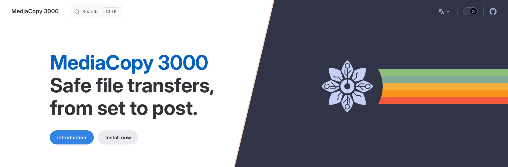

  <h1> MediaCopy 3000 </h1>
  

    
  

## Features

* Integrity verification through the ASC Media Hash List (MHL) manifest format
* Sealing of a media source in place, so a later copy has original hashes to check against
* Plan review before execution, so that all actions are accounted for.

## Development

Read [`CONTRIBUTING.md`](CONTRIBUTING.md) for the building and packaging processes.

## Acknowledgements

* [Guerilla.Studio](https://guerilla.studio) for the idea
* [Pomfort GmbH](https://pomfort.com) for the domain knowledge
