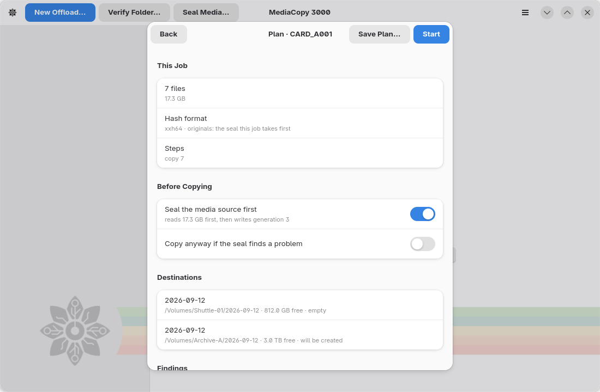
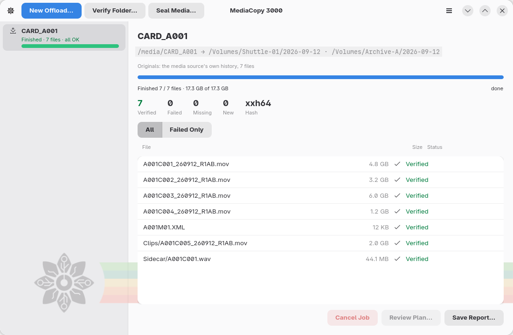

## Glossary

These are the terms used throughout the manual and the codebase:

<dl>
  <dt>Media source</dt>
  <dd>The source a job reads: a camera card, an SSD, or any folder. Only a seal writes
  to it, and only in its <code>ascmhl</code> folder.
  </dd>
  <dt>Destination</dt>
  <dd>A folder an offload copies into.</dd>
  <dt>Manifest</dt>
  <dd>One <code>.mhl</code> file. It holds a hash for every file in the tree it sits in.</dd>
  <dt>Generation</dt>
  <dd>A manifest in a folder's history, numbered from 1.</dd>
  <dt>Chain</dt>
  <dd>The file that names every generation in order, and holds a hash of each one.</dd>
  <dt>Seal</dt>
  <dd>The recording of a media source's hashes in place, before anything is copied off it.</dd>
  <dt>Offload</dt>
  <dd>
    The copying of a media source to one or more destinations, and checking of each copy.
    Each destination carries the media source's history.
  </dd>
  <dt>Verify</dt>
  <dd>Reading a folder again and checking it against its own history.</dd>
  <dt>Plan</dt>
  <dd>What a job will do, computed before the job runs.</dd>
  <dt>Finding</dt>
  <dd>Something the plan learned that you must know. A blocker or a warning.</dd>
</dl>
