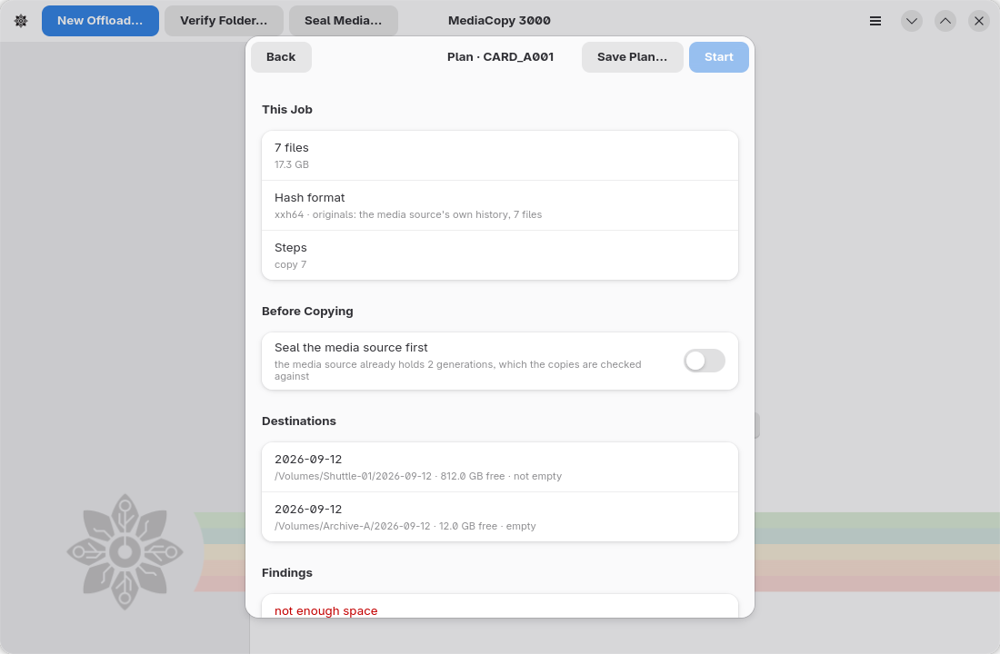

# Constats

Un constat est une information relevée par le plan dont vous devez prendre connaissance. Chaque constat constitue soit un blocage, soit un avertissement.

- Un **blocage** empêche le lancement de la tâche. Le bouton **Start** reste grisé.
- Un **avertissement** n’empêche aucune action.



Chaque constat est associé à un code. Ce code est identique dans l’interface, dans le rapport et dans les tests ; il ne peut donc y avoir de divergence entre ces trois éléments quant à la nature du constat.

## Pourquoi un blocage n’est pas une question

Un blocage n’est pas une question. La fiche ne comporte aucun bouton permettant de le valider. La tâche ne peut démarrer tant que la cause du blocage n’a pas été éliminée.

Le blocage `la destination contient des fichiers absents de la source` en illustre la raison. Lors d’un déchargement, chaque fichier est d’abord écrit sous un nom temporaire avant d’être renommé avec son nom définitif. Si l’écriture d’un nouveau fichier échoue, la tâche supprime les deux noms. Si l’écriture échoue alors qu’un fichier existe déjà, la tâche supprime le nom temporaire et conserve l’ancien fichier. La tâche ne peut garantir ce comportement que pour les fichiers qu’elle connaît, c’est-à-dire ceux de la source. Un fichier inconnu risquant d’être perdu, la fiche refuse le dossier sélectionné.

## Blocages

| Message affiché | Signification | Action requise |
|---|---|---|
| `source introuvable` | La source est introuvable au chemin indiqué. | Montez le volume ou sélectionnez à nouveau le chemin. |
| `la destination contient une copie partielle` | La destination contient déjà certains fichiers provenant de cette source. | Choisissez **Resume** ou **Replace** dans le groupe **Before Copying**. La page [Décharger une source multimédia](offload.md) explique ces deux options. |
| `la destination contient des fichiers absents de la source` | La destination contient un fichier, un dossier ou une génération absents de la source. | Sélectionnez un dossier vide ou un dossier qui n’existe pas encore. Les détails indiquent le premier élément (fichier, dossier ou génération) concerné, dans l’ordre de tri. |
| `la destination a été copiée depuis une autre source` | La destination contient un historique dont une génération ne correspond pas à celle, portant le même nom, de la source multimédia. | Choisissez une autre destination ou vérifiez ce dossier avec la commande **Vérifier le dossier…**. |
| `la destination est illisible` | Le dossier n’a pas pu être lu du tout. | Vérifiez que le volume est monté et que vous disposez des droits d’écriture dessus. |
| `l’historique de la destination est illisible` | La destination contient un dossier `ascmhl`, mais sa chaîne ou un manifeste qu’elle référence n’a pas pu être lu. | Lisez la destination avec un autre outil ASC MHL ou choisissez une autre destination. |
| `espace insuffisant` | L’espace libre sur la destination est insuffisant pour la tâche. | Libérez de l’espace ou choisissez un autre volume. |
| `le format d’empreinte ne peut pas être fixé` | Les enregistrements que cette tâche doit vérifier contiennent plusieurs formats d’empreinte. | Vérifiez d’abord le dossier dans un format donné ou déchargez vers une destination vierge. |
| `la chaîne ne nomme aucun manifeste` | Le fichier de chaîne est présent mais ne référence aucune génération. Un sceau précédemment créé a été perdu. | Lisez le dossier avec un autre outil ASC MHL avant d’y écrire quoi que ce soit d’autre. |
| `la chaîne est illisible` | Le fichier `ascmhl_chain.xml` est corrompu ou ne correspond pas au fichier attendu. | Consultez les détails, qui indiquent le nom du fichier et l’erreur d’analyse. |
| `un manifeste nommé par la chaîne est illisible` | Un manifeste référencé par la chaîne est absent ou illisible (erreur d’analyse). | Les détails indiquent le nom du fichier ainsi que la mention `missing` ou l’erreur d’analyse. |
| `le dossier n’a pas d’historique` | Une tâche de vérification a été lancée sur un dossier dépourvu de dossier `ascmhl`. | Scellez plutôt le dossier. Seule une tâche de vérification déclenche ce message. |

## Avertissements

| Message affiché | Signification | Action recommandée |
|---|---|---|
| `la source est vide` | La source multimédia ne contient aucun fichier. | Vérifiez que vous avez sélectionné le bon dossier. La tâche peut s’exécuter mais n’enregistrera rien. |
| `le dossier est déjà scellé` | La source multimédia contient déjà une génération, et cette tâche en créerait une autre. | Désactivez l’option **Seal the media source first** ou utilisez **Vérifier le dossier…**. |

## Constats des extensions

Une [extension](plugins.md) peut ajouter ses propres constats. Leur texte vient de l’extension,
après son nom. Une extension ne peut donner un blocage que si vous lui accordez `block` et `plan.inspect`.

MediaCopy 3000 donne lui-même trois constats sur les extensions :

| Message affiché | Signification | Action requise |
|---|---|---|
| `extension indisponible` | L’extension n’a pas répondu à temps, ou a refusé de démarrer. Le détail donne la raison. | Lancez `mediacopy3000 plan` et lisez sa sortie d’erreur. Réparez l’extension, ou mettez `enabled` à `false` dans `plugins.json`. |
| `le champ … n’a pas de valeur valide` | Un réglage ou un champ de tâche de l’extension n’a pas de valeur, ou a une valeur que l’extension n’accepte pas. | Donnez la valeur dans `plugins.json`, ou avec `--plugin-field`. |
| `l’extension a envoyé une réponse invalide` | La réponse ne respecte pas le protocole, par exemple des métadonnées hors de l’espace de noms de l’extension. | Prévenez l’auteur de l’extension. Le détail donne la raison. |

Chacun des trois est un blocage pour une extension avec `manifest.write`, et pour une extension avec
la capacité `block` et `plan.inspect`. Pour toute autre extension, c’est un avertissement.

## Constats dans le rapport

Chaque constat figure dans le bloc `Plan` du rapport enregistré, accompagné de sa gravité et de ses détails :

```
  warning: folder is already sealed – generation 2
```

Le rapport conserve les avertissements que vous avez acceptés, de sorte que la décision reste associée à l’enregistrement.
