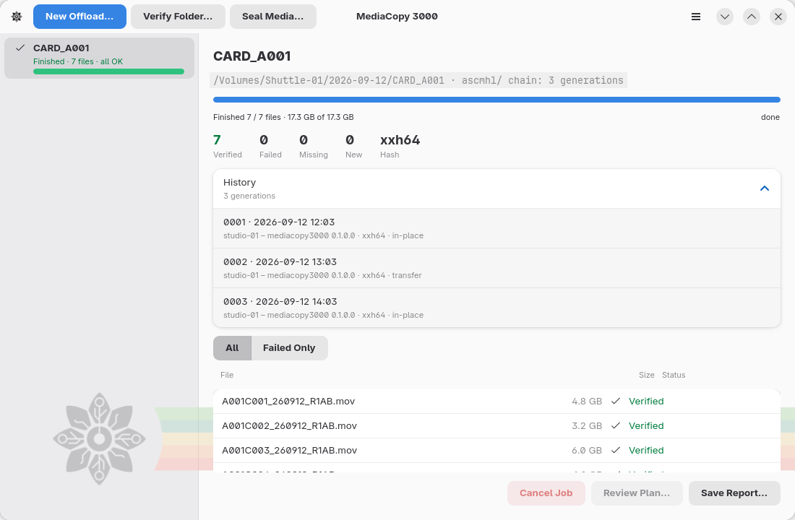

# Historique et générations

L’historique d’un dossier correspond à son dossier `ascmhl`. Il contient un
fichier de chaîne (*chain file*) et un manifeste pour chaque opération ayant
enregistré ce dossier. Chaque opération ajoute une génération à la fin. Aucune
opération ne modifie une génération antérieure.



## Ce qu’affiche la vue détaillée

Le volet de détails d’une vérification ou d’un scellement comporte une ligne **History**. Cliquez dessus pour l’ouvrir. Chaque ligne interne représente une génération :

```
0002 · 2026-09-12 13:03
studio-01 – mediacopy3000 0.1.0.0 · xxh64 · transfert
```

Une génération comportant des échecs voit sa seconde ligne se terminer par ` · 2 failures`.

| Contenu de la ligne | Signification |
|---|---|
| `0002` | Le numéro de la génération. Les générations sont numérotées à partir de 1 et ne sont jamais réutilisées. |
| `2026-09-12 13:03` | Date et heure d’écriture de la génération. |
| `studio-01` | L’ordinateur ayant effectué l’écriture. |
| `mediacopy3000 0.1.0.0` | L’outil utilisé pour l’écriture et sa version. |
| `xxh64` | Le format d’empreinte (*hash*) de cette génération. |
| `transfert` | Le processus de la génération. |
| ` · 2 failures` | Nombre de fichiers non conformes. La ligne s’affiche en rouge. |

Un déchargement ne comporte pas une telle ligne. Sa
destination conserve l’historique de la source ainsi qu’une nouvelle génération ;
une vérification de la destination permet de les visualiser. Un déchargement
repris après interruption conserve le même historique qu’un
déchargement complet.

## Signification des termes désignant le processus

La spécification en autorise trois, et aucun autre :

| Terme | Signification |
|---|---|
| `in-place` | L’empreinte des fichiers a été calculée à leur emplacement d’origine. Un scellement et une vérification écrivent tous deux ce processus. |
| `transfer` | Les fichiers ont été copiés dans ce dossier, et l’empreinte de leurs copies a été calculée à cet emplacement. |
| `flatten` | Les fichiers ont été copiés dans un dossier unique, sans conserver leur structure de répertoires. |

## L’importance de la chaîne

Le fichier de chaîne est `ascmhl/ascmhl_chain.xml`. Il répertorie chaque génération dans l’ordre et contient une empreinte `c4`
pour chaque fichier manifeste.

La chaîne définit le contenu de l’historique. La liste des fichiers du dossier ne le définit pas. L’empreinte `c4` permet
à un lecteur de déterminer si un manifeste a été modifié après sa création.

MediaCopy 3000 écrit cette empreinte et la renseigne pour les anciennes entrées
qui en sont dépourvues. En revanche, il ne compare pas le manifeste à cette
empreinte lors de la lecture de l’historique ; cette vérification peut être
effectuée par un autre outil ASC MHL.

MediaCopy 3000 rejette tout historique dont la chaîne mentionne un manifeste
absent ou dont la chaîne est illisible. Ces deux cas constituent des blocages.
Ils sont répertoriés sur la page [Constats](findings.md).
