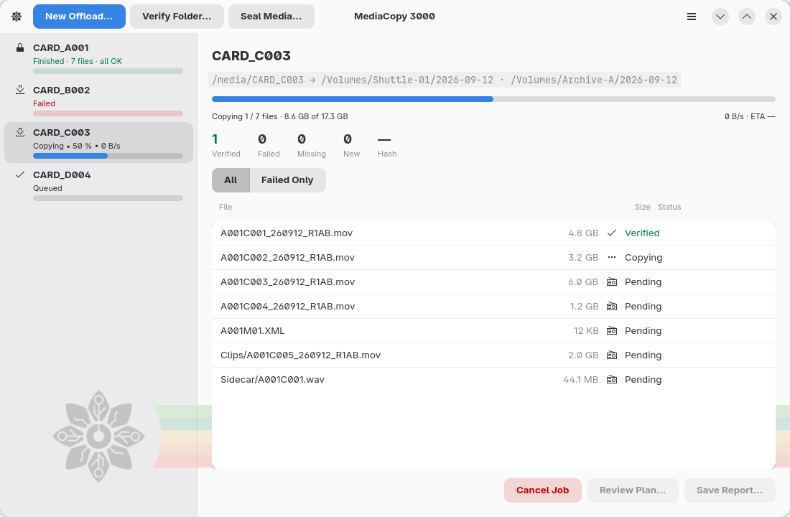

# Introduction

MediaCopy 3000 copie vos médias et en garde un historique. L'application
est faite pour à la fois les ingénieurs vision (en anglais DIT, _Digital
Imaging Technician_) sur les plateaux de tournage, et les hobbyistes qui veulent
transférer leurs données de manière sécurisée.

MediaCopy 3000 lit et écrit le standard
[ASC Media Hash List](mhl-format.md).
Le format garantit deux choses au sujet d'une copie :
**L'intégrité** (les octets n'ont pas changé) et la **complétude** (tous les
fichiers sont présents). Chaque transfert écrit un manifeste et l'ajoute
à la chaîne du dossier de destination. Cette chaîne constitue l'historique de
vos fichiers.

