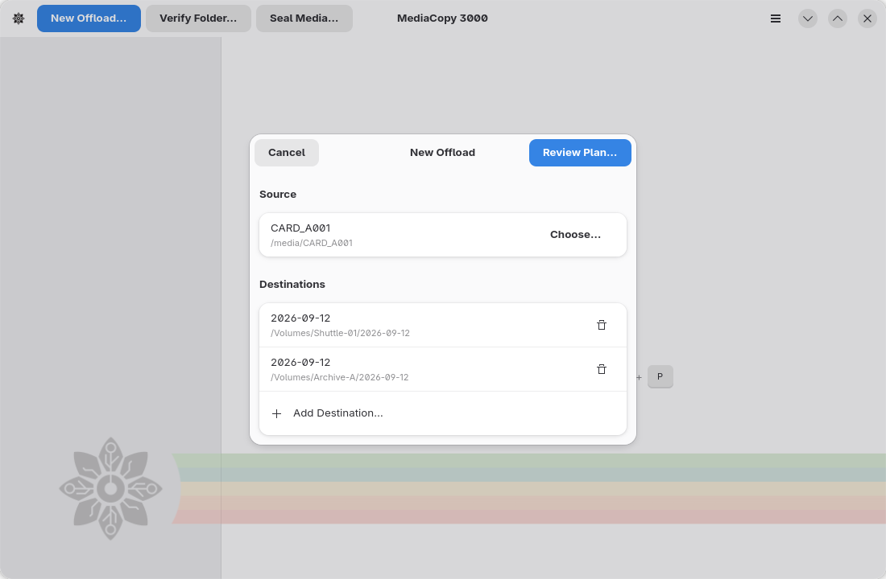
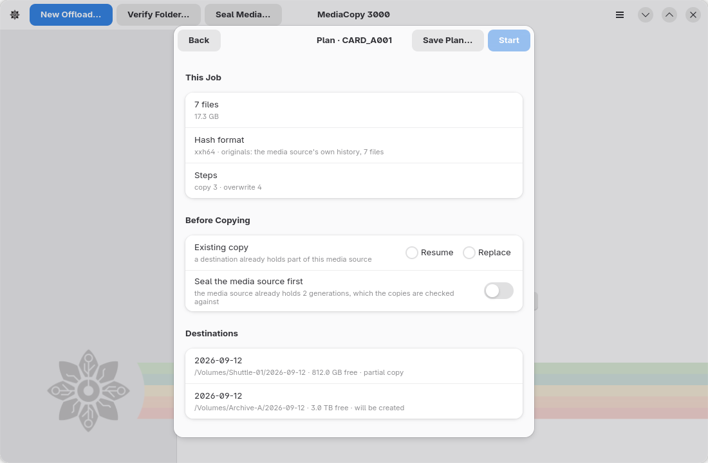

# Décharger une source multimédia

Un déchargement copie une source multimédia vers une ou plusieurs
destinations. La tâche calcule l’empreinte (*hash*) de chaque fichier lors de
sa lecture, et écrit le manifeste dans chaque destination.

Il est possible de sceller la source multimédia avant de lancer la copie. La page
[Sceller d’abord la source multimédia](seal-first.md) explique cette option.

## Lancer le déchargement

1. Cliquez sur **Nouveau déchargement…** ou appuyez sur <kbd>Ctrl</kbd>+<kbd>N</kbd>.
2. Cliquez sur **Choose…** et sélectionnez la source multimédia.
3. Cliquez sur **Add Destination…** et sélectionnez un dossier. Répétez l’opération pour une deuxième destination.
4. Cliquez sur **Review Plan…**.



Le bouton **Review Plan…** reste grisé tant que la boîte de dialogue ne contient pas une source multimédia et au moins une
destination. Il est impossible d’ajouter deux fois le même dossier.

Pour supprimer une destination, cliquez sur **Remove Destination** sur la ligne correspondante.

**Review Plan…** ne lance aucune copie. Cette action lit la source multimédia ainsi que les destinations et
affiche un plan. La page [Le plan](the-plan.md) explique les informations contenues dans ce plan. La copie débute
lorsque vous cliquez sur **Start** sur la fiche du plan.

## Ce qu’écrit le déchargement

Chaque destination reçoit un dossier portant le même nom que la source multimédia. À l’intérieur de ce dossier, les fichiers sont à leur emplacement d’origine, dossiers vides compris, à côté d’un dossier `ascmhl` :

```
<destination>/CARD_A001/…les fichiers…
<destination>/CARD_A001/ascmhl/ascmhl_chain.xml
<destination>/CARD_A001/ascmhl/0001_CARD_A001_2026-09-12_120000.mhl
<destination>/CARD_A001/ascmhl/0002_CARD_A001_2026-09-12_140300.mhl
```

Le dossier `ascmhl` correspond à l’historique propre de la source multimédia, copié fichier par fichier, auquel s’ajoute une nouvelle génération pour ce déchargement. Dans cet exemple, `0001` représente le sceau déjà présent sur la carte, tandis que `0002` correspond au déchargement. Une source multimédia sans historique donne une destination dont la première génération est le déchargement lui-même. Chaque destination reçoit sa propre copie, car chaque destination constitue une arborescence distincte. La page [Le format ASC MHL](mhl-format.md) détaille ce point.

Un déchargement n’écrit aucune donnée sur la source multimédia, sauf si l’option **Seal the media source first** est activée. Le scellement écrit alors une génération dans le dossier `ascmhl` de la source multimédia.

## Éléments de comparaison pour la vérification de la copie

Lors d’un déchargement, chaque fichier est enregistré comme `verified` lorsqu’il est possible de comparer la copie à une empreinte existante, et comme `original` dans le cas contraire. Les empreintes utilisées pour la comparaison sont les **originaux**. Elles proviennent de l’une des trois sources suivantes :

- L’historique propre de la source multimédia, lorsqu’elle en possède un.
- Le sceau que la tâche crée d’abord, si l’option **Seal the media source first** est activée.
- Aucune source, lorsque la source multimédia ne contient pas d’historique. Chaque fichier est alors enregistré comme `original`.

Le plan indique laquelle des trois sources a été utilisée, et le volet de détails la rappelle sur la ligne `Originals:`.
La page [Sceller d’abord la source multimédia](seal-first.md) explique ce choix.

## Reprendre un déchargement annulé

Vous pouvez décharger vers une destination qui contient déjà une partie de la même source multimédia. La fiche du plan affiche alors le blocage `la destination contient une copie partielle` et marque la destination comme `copie partielle`. Elle ajoute également une ligne **Existing copy** dans le groupe **Before Copying**. Choisissez l’une des options suivantes :

- **Resume** conserve les fichiers qui ont la taille et l’empreinte correctes. La tâche calcule l’empreinte de chacun de ces fichiers et ne le copie à nouveau que si l’empreinte diffère. Un tel fichier porte la mention `Remplacé après une différence`.
- **Replace** copie à nouveau tous les fichiers, en écrasant ceux qui sont déjà présents.

Ces deux choix aboutissent au même résultat qu’un déchargement complet : l’arborescence complète, l’historique de la source multimédia et une nouvelle génération.



La destination ne doit contenir que les fichiers de la source multimédia, les
copies incomplètes de ces fichiers, dont le nom se termine par `.mc3k-part`, et l’historique
de la source multimédia elle-même. La présence d’un fichier absent de la source
multimédia constitue un blocage. La page [Constats](findings.md) décrit ce
blocage.

## Annuler une tâche

Cliquez sur **Annuler la tâche** dans le volet de détails pendant l’exécution de la tâche. Les fichiers déjà copiés restent à leur emplacement.

Une tâche annulée n’écrit pas de manifeste pour la passe en cours lors de l’arrêt. Une passe de scellement déjà terminée a, quant à elle, déjà inscrit sa génération dans la source multimédia.

Vous pouvez relancer le même déchargement vers la même destination. La section ci-dessus explique la procédure.
