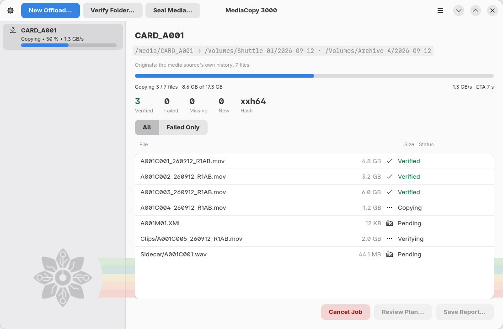
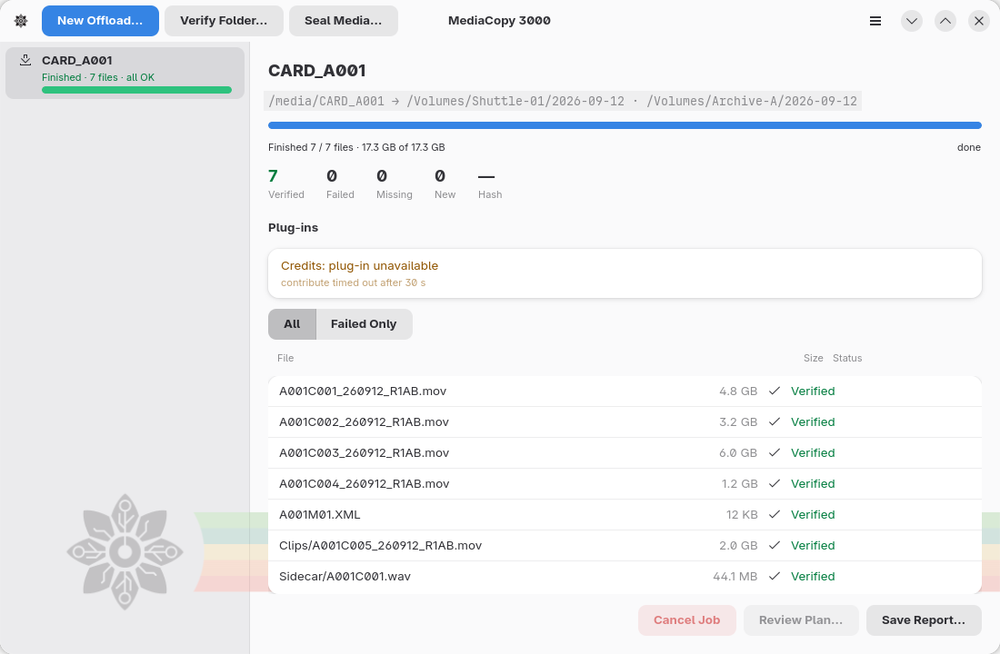
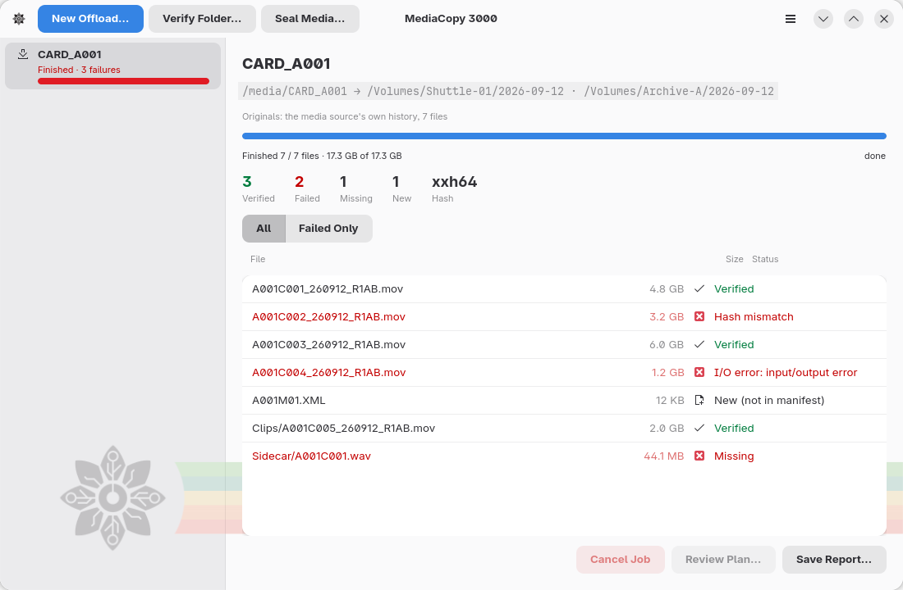
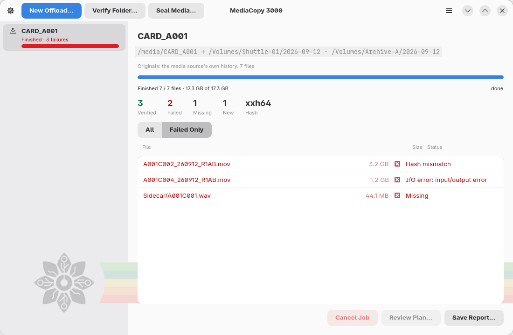
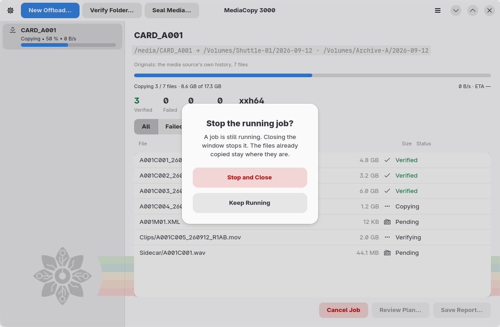

# Pendant l’exécution d’une tâche

## La partie supérieure du volet

La première ligne indique le nom du dossier lu par la tâche. La ligne située en dessous affiche le ou les chemins d’accès :

- Pour un déchargement, l’affichage est : `<source multimédia> → <destination> · <destination>`.
- Pour une vérification ou un scellement, l’affichage est : `<dossier> · ascmhl/ chain: 3 generations`.

Un déchargement affiche également une ligne `Originals:`, qui indique les empreintes (*hash*) auxquelles la tâche compare ses copies.

## Progression

La barre de progression représente uniquement les octets. La ligne située en dessous indique deux informations : le nombre de fichiers traités par rapport au total prévu, puis le nombre d’octets traités par rapport au total prévu.

Le total d’octets comptabilise les lectures prévues par le plan. Un déchargement lit chaque fichier pour le copier, puis relit chaque copie pour la comparer. Une tâche qui scelle avant la copie lit la source multimédia une fois de plus. Une tâche qui poursuit une copie précédente lit également chaque fichier déjà présent à la destination.

Une lecture n’est pas incluse dans ce total : si un fichier à la destination ne correspond pas à celui de la source multimédia, la tâche copie à nouveau ce fichier et relit la nouvelle copie. Aucun plan ne peut prévoir cela avant le démarrage ; la barre peut donc rester à 100 % pendant que la tâche traite ce fichier.

À droite de cette ligne, une tâche en cours affiche son débit et une estimation du temps restant. Cette estimation correspond au nombre d’octets restants divisé par le débit mesuré ; elle varie en fonction des fluctuations du débit.

Deux étapes de la copie n’impliquent aucun transfert d’octets : l’écriture des données sur le disque et l’attribution du nom final à la copie. L’application ne peut pas mesurer de débit pour ces étapes.

Au même endroit s’affichent ensuite l’état du fichier et une durée, par exemple `Écriture sur le disque · 14 s`. Cette durée correspond au temps écoulé depuis la dernière activité détectée. Elle s’affiche après deux secondes.

Une durée qui augmente n’indique pas une erreur. Un fichier volumineux sur un disque lent reste à l’état `Écriture sur le disque` pendant plusieurs secondes. Si cette durée dépasse quelques minutes, examinez le disque.

La tâche affiche cette durée lorsqu’elle traite un fichier et lorsqu’elle écrit un manifeste. Entre deux fichiers,
et avant le premier fichier (pendant que la tâche lit les originaux), aucune durée n’est affichée.

Une tâche écrit un manifeste vers chaque destination à la fin de son exécution ; une tâche qui effectue d’abord un scellement en écrit également un
sur la source multimédia. Elle attend que le disque prenne en compte chaque manifeste. Cette attente peut être longue sur un disque lent,
et la ligne indique `Écriture du manifeste · 25 s`.

## Les compteurs

| Compteur | Ce qu’il compte |
|---|---|
| `Verified` | Fichiers qui correspondent à une empreinte existante |
| `Failed` | Fichiers dont l’empreinte ne correspondait pas, et fichiers illisibles |
| `Missing` | Fichiers mentionnés dans l’historique mais absents du disque |
| `New` | Fichiers présents sur le disque mais non mentionnés dans un manifeste |
| `Hash` | Format d’empreinte utilisé par cette tâche |

`Verified` passe au vert et `Failed` passe au rouge dès que leur valeur dépasse zéro.

## Extensions

Quand des [extensions](plugins.md) prennent part à une tâche, le groupe **Plug-ins**
vient après les compteurs.

| Ligne | Signification |
|---|---|
| `Inspecting: 3 files left` | Les extensions avec `files.inspect` examinent les fichiers vérifiés. |
| `Credits : extension indisponible` | Une extension a échoué, ou a trouvé un problème. Le texte commence par le nom de l’extension. |
| `<name>: 4 files not inspected` | Une extension avec `files.inspect` a échoué deux fois. Les fichiers restants n’ont pas de notes de sa part. |

Le premier avertissement de chaque extension dans une tâche affiche aussi une notification en bas de
la fenêtre.

## La liste des fichiers

Une ligne par fichier : le nom, la taille et l’état.

| État | Signification |
|---|---|
| `En attente` | La tâche n’a pas encore atteint ce fichier. |
| `Calcul de l’empreinte` | La tâche lit le fichier pour calculer son empreinte. |
| `Copie` | La tâche écrit le fichier vers une destination. |
| `Écriture sur le disque` | La tâche attend que le disque prenne en compte les octets écrits. |
| `Nommage de la copie` | La tâche attribue à la copie son nom définitif. |
| `Vérification` | La tâche relit une copie pour la comparer. |
| `Vérifié` | L’empreinte correspondait à l’enregistrement. |
| `Empreinte différente` | L’empreinte ne correspondait pas à l’enregistrement. Le fichier n’est pas celui que l’enregistrement décrit. |
| `Manquant` | Un manifeste mentionne ce fichier, mais il est absent du disque. |
| `Nouveau (absent du manifeste)` | Le disque contient ce fichier, mais aucun manifeste ne le mentionne. |
| `Erreur d’E/S : …` | Le fichier n’a pas pu être lu. Le message provient du système d’exploitation. |
| `Remplacé après une différence` | Le fichier était déjà présent à la destination, mais son empreinte différait. La tâche l’a copié à nouveau. |

Les boutons **All** et **Failed Only** permettent de filtrer la liste. Utilisez **Failed Only** pour une source multimédia volumineuse contenant, par exemple, trois fichiers défectueux parmi quatre cents fichiers sains.

## Annuler une tâche

**Annuler la tâche** interrompt une tâche en file d’attente, en cours d’exécution ou en attente de validation. Les fichiers déjà copiés restent à leur emplacement.

Vous pouvez relancer le déchargement vers la même destination. La page [Décharger une source multimédia](offload.md) explique cette procédure.

## Enregistrer le rapport

Le bouton **Enregistrer le rapport…** devient disponible une fois la tâche terminée. Il écrit un fichier texte qui consigne les opérations effectuées par la tâche, y compris le plan que vous avez validé. La page [Rapports](reports.md) détaille chaque ligne de ce fichier.

La page [La ligne de commande](command-line.md) explique comment établir un plan sans passer par la fenêtre.

## Fermer la fenêtre pendant l’exécution d’une tâche

La fenêtre ne se ferme jamais automatiquement pendant l’exécution d’une tâche ; une confirmation est demandée au préalable.

- **Keep Running** laisse la tâche se poursuivre.
- **Stop and Close** arrête la tâche et ferme la fenêtre. Les fichiers déjà copiés restent à leur
  emplacement.
