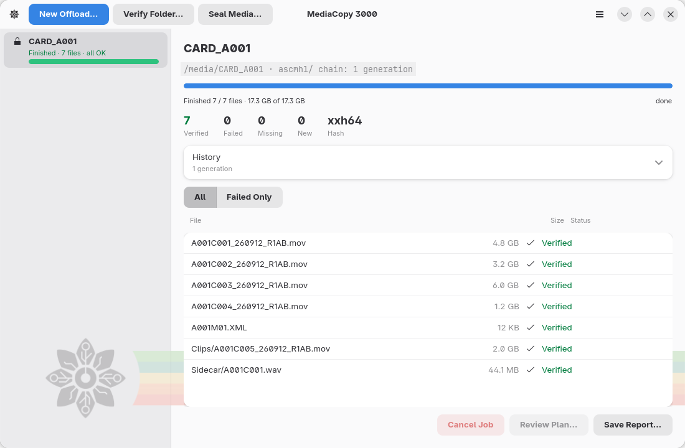

# Sceller une source multimédia

Un scellement lit un dossier, calcule l’empreinte (*hash*) de chaque fichier et
écrit le résultat dans un sous-dossier nommé `ascmhl` situé à l’intérieur de ce
même dossier. Aucun fichier n’est copié ni déplacé.

## Lancer un scellement

1. Cliquez sur **Sceller le support…** ou appuyez sur <kbd>Ctrl</kbd>+<kbd>L</kbd>.
2. Sélectionnez la source multimédia.
3. Lisez le plan, puis cliquez sur **Start**.

## Pourquoi sceller une source

Un scellement fournit un point de comparaison pour un déchargement
ultérieur. Sans lui, un déchargement peut seulement prouver que chaque copie
correspond à ce qui a été lu sur la source multimédia. Avec lui, il est possible
de prouver que ce qui a été lu correspond toujours à ce qui était présent au
moment du scellement.

Un scellement écrit des données sur la source multimédia. C’est
également le cas d’un déchargement effectué avec l’option **Seal the media
source first** activée, car cette option exécute le même scellement. Toutes
les autres tâches laissent la source dans l’état où elles l’ont trouvée.

Si la source multimédia est protégée en écriture, ou si vous ne souhaitez rien y inscrire, ne la scellez pas et laissez cette option désactivée. Chaque fichier sera alors enregistré comme `original`.

## Ce qui est enregistré

Un scellement enregistre chaque fichier comme `original`, car il s’agit
des premières empreintes calculées pour ces fichiers. Il utilise
le format `xxh64` pour un dossier qui ne contient aucun historique. Pour un
dossier qui en contient déjà un, il utilise le format de l’historique existant.

La génération enregistre le processus `in-place` (sur place).

## Sceller un dossier déjà scellé

Le plan affiche l’avertissement `le dossier est déjà scellé`
et précise la génération qu’il contient déjà. La tâche peut tout de même
être exécutée. Elle écrit une nouvelle génération qui indique que les fichiers
produisent toujours les mêmes empreintes. Ce résultat est le même que celui
d’une vérification.

Pour cette opération, utilisez plutôt **Vérifier le dossier…**.
