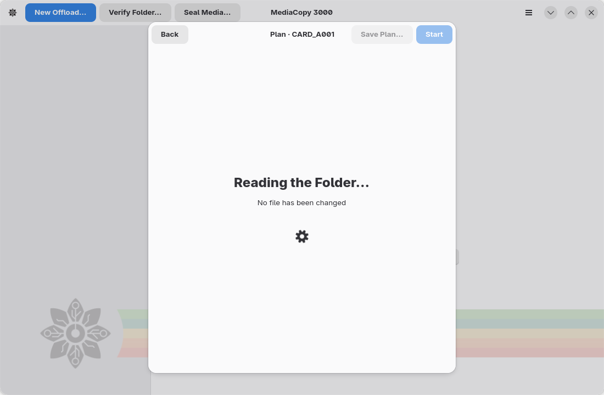
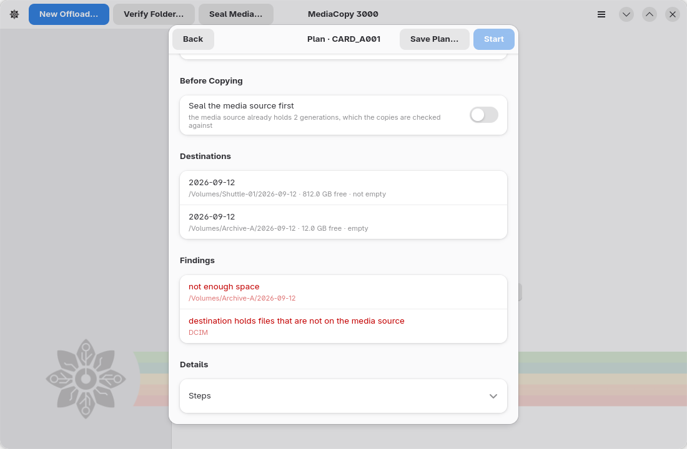
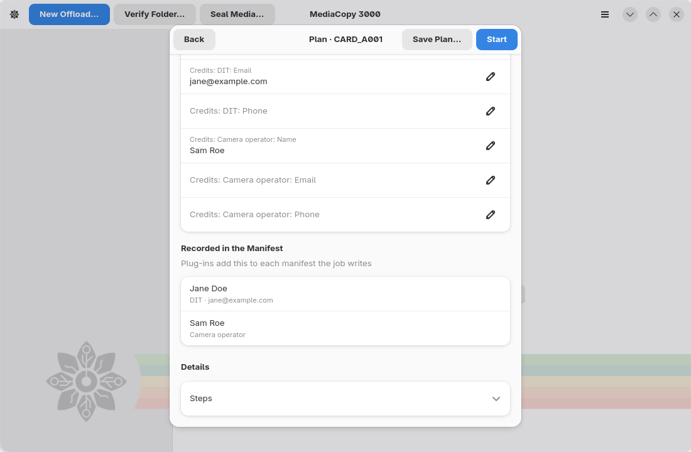
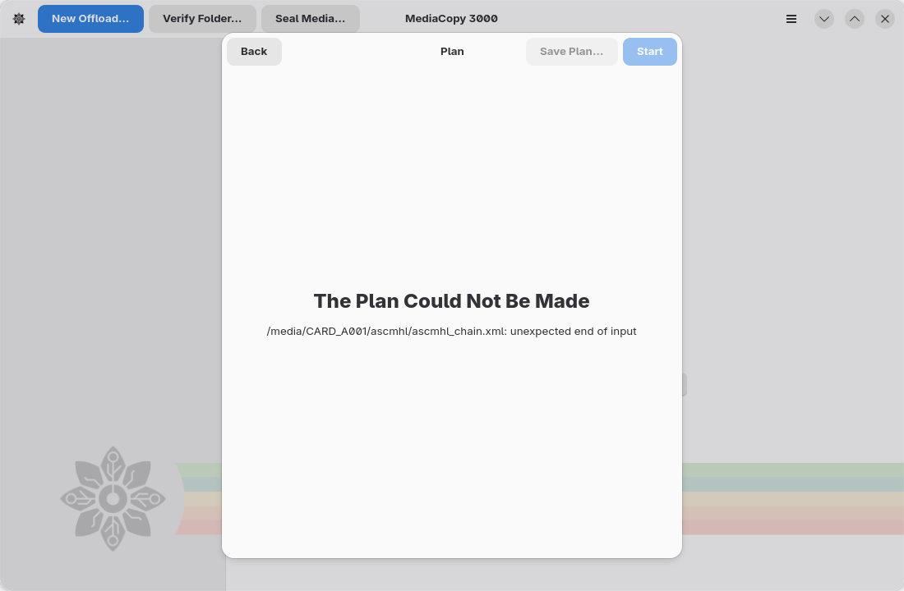

# Le plan

La fiche du plan indique ce qu’une tâche va faire avant de l’exécuter.

Toutes les tâches passent par cette étape : un déchargement après un clic sur
**Review Plan…**, une vérification ou un scellement dès la sélection du
dossier.

## Pendant la lecture

La fiche affiche `Reading the Folder…` et `No file has been changed`. L’analyse d’une source multimédia contenant de nombreux fichiers peut prendre quelques secondes.

## Une fois prêt

Cette fiche se compose de ces groupes :

### Cette tâche

| Ligne | Signification |
|---|---|
| `7 files` | Nombre de fichiers que la tâche va traiter. Le sous-titre indique la taille totale (en octets) de ces fichiers ; ce calcul n’inclut pas la passe de scellement. |
| `Hash format` | Le format d’empreinte unique utilisé par la tâche, ainsi que l’origine des originaux. |
| `Steps` | Les actions que la tâche effectuera, comptées par type : `copie`, `missing`, `record`, `réutilisation`, `verify`, `écrasement`. La fiche les liste dans cet ordre. |

Une tâche adopte un format d’empreinte unique pour tous les fichiers. Elle
détermine ce format à partir des enregistrements de référence. Si rien ne
l’impose, elle utilise `xxh64`.

`missing` compte les fichiers présents dans l’historique mais absents du disque.

`réutilisation` compte les fichiers déjà présents sur toutes les destinations avec
la taille correcte. La tâche calcule l’empreinte de chacun et ne le copie que
si l’empreinte diffère. `écrasement` compte les fichiers que la tâche copie
par-dessus un fichier déjà présent sur une destination. Un fichier présent sur
une destination mais absent d’une autre est compté comme `copie`. Tant que
vous n’avez pas choisi **Resume** ou **Replace**, le décompte affiche le
cas **Replace**.

### Avant la copie

Ce groupe, **Before Copying**, concerne uniquement les déchargements. Il contient les deux
options expliquées sur la page [Sceller d’abord la source multimédia](seal-first.md). Il
affiche également la ligne **Existing copy** lorsqu’une destination contient
une copie partielle.

### Destinations

Une ligne par destination : le chemin complet, l’espace libre et l’état du dossier.

| État | Signification |
|---|---|
| `vide` | Le dossier existe et est vide. |
| `non vide` | Le dossier contient un fichier, un sous-dossier ou une génération absents de la source multimédia. Cela constitue un blocage. |
| `sera créé` | Le dossier n’existe pas encore. La tâche le créera. |
| `copie partielle` | Le dossier contient certains fichiers de cette source multimédia et rien d’autre. Vous devez choisir **Resume** ou **Replace**. |

### Constats

Un constat est une information importante relevée par le plan. Les blocages
apparaissent en premier, suivis des avertissements.

- Un **blocage** interrompt la tâche. Le bouton **Start** reste grisé tant qu’un blocage est présent.
- Un **avertissement** n’interrompt rien. Prenez-en connaissance et décidez de la marche à suivre.

La page [Constats](findings.md) répertorie tous les constats possibles et les actions à entreprendre pour chacun d’eux.

Une [extension](plugins.md) peut aussi ajouter des constats. Le texte de chacun commence par le nom
de l’extension.

### Champs de tâche

Ce groupe, **Job Fields**, montre les [champs de tâche](plugins.md#champs-de-tache) de chaque extension activée.
Chaque ligne a le nom de l’extension, puis le nom du champ. Tapez une valeur, puis cliquez sur le
bouton d’application. La fiche établit le plan à nouveau avec la valeur. Le groupe n’apparaît pas
quand aucune extension ne demande de champ de tâche.

### Enregistré dans le manifeste

Ce groupe, **Recorded in the Manifest**, montre ce que les extensions ajoutent à chaque manifeste que la tâche écrit. Il a une
ligne pour chaque auteur, et une ligne pour les métadonnées avec le nom des extensions qui les
ajoutent. Le groupe n’apparaît pas quand aucune extension n’ajoute rien.

## Lorsque le plan ne peut pas être établi

La fiche, intitulée `The Plan Could Not Be Made`, indique la raison de l’échec. La cause la plus fréquente est
l’impossibilité de lire un fichier de chaîne. Aucune modification n’a été
apportée aux disques.

Le plan échoue aussi quand une [extension](plugins.md) ne démarre pas, ou s’arrête pendant que le
plan est établi. La fiche nomme l’extension. Réparez l’extension, ou mettez `enabled` à
`false` dans `plugins.json`.

## Démarrer ou revenir en arrière

**Start** ajoute la tâche à la liste et l’exécute, ou la place en file d’attente si une autre tâche est déjà en cours.

**Back** annule le plan sans rien modifier. La touche <kbd>Échap</kbd> et le bouton de fermeture produisent le même effet.

## Enregistrer le plan

**Save Plan…** permet d’enregistrer la fiche du plan sous forme de
fichier texte. Ce bouton est disponible une fois le plan prêt. Le fichier
contient le même bloc `Plan` que celui présent dans un rapport enregistré.
Joignez-le à tout signalement de problème.

## Relecture du plan

Une seule tâche s’exécute à la fois. Une tâche en attente est planifiée à nouveau
lorsqu’elle arrive en tête de file, car l’état du disque peut changer pendant
l’attente.

Si le nouveau plan est identique à celui que vous avez approuvé, la tâche
s’exécute. Si ce n’est pas le cas, la tâche passe à l’état `Needs review` et le
nouveau plan revient sur cette fiche pour que vous le validiez à nouveau.
