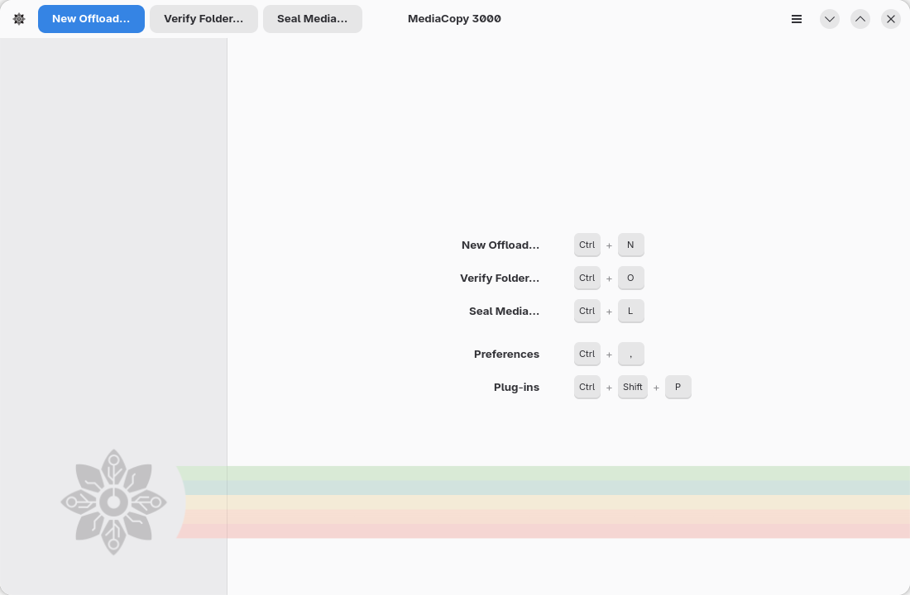

# La fenêtre principale

La fenêtre principale a trois parties : la barre d’en-tête, la liste des tâches et le volet de détails.

## La barre d’en-tête

Les trois boutons situés à gauche servent pour trois types de tâche :

| Bouton | Tâche |
|---|---|
| **Nouveau déchargement…** | Un déchargement. La page [Décharger une source multimédia](offload.md) l’explique. |
| **Vérifier le dossier…** | Une vérification. La page [Vérifier un dossier](verify.md) l’explique. |
| **Sceller le support…** | Un scellement. La page [Sceller une source multimédia](seal.md) l’explique. |

À droite se trouve le bouton de menu, qui s’ouvre avec la touche <kbd>F10</kbd>.

## La liste des tâches

La liste sur la gauche contient les tâches, une par ligne, avec leur phase et une barre de progression.

| La ligne indique | Signification |
|---|---|
| `Queued` | La tâche attend son tour. Une seule tâche est exécutée à la fois. |
| `Needs review` | La tâche a été planifiée à nouveau et le plan a changé. La fiche du plan attend votre réponse. |
| `Copie • 42 % • 310,0 Mo/s` | Un déchargement est en cours. Le nombre est la part des octets traités sur les octets prévus, puis vient le débit. |
| `Écriture du manifeste · 25 s` | La tâche a lu ou écrit tous les fichiers, et écrit maintenant son manifeste. La durée est le temps passé à attendre le disque. |
| `Écriture sur le disque · 14 s` | La tâche n’a transféré aucun octet depuis quelques secondes. Les mots indiquent l’état du fichier en cours de traitement, et la durée est le temps passé dans cet état. La page [Pendant l’exécution d’une tâche](running-a-job.md) l’explique. |
| `Vérification…` | Une vérification est en cours. |
| `Scellement…` | Un scellement est en cours. |
| `Finished · 7 files · all OK` | Tous les fichiers sont conformes. La ligne passe au vert. |
| `Finished · 2 failures` | Certains fichiers ne sont pas conformes. La ligne passe au rouge. |
| `Failed` | La tâche s’est arrêtée avant son terme. Un message au bas de la fenêtre en indique la raison, et le rapport la conserve. |
| `Cancelled` | Vous avez annulé la tâche. |

Cliquez sur une ligne pour sélectionner la tâche. <kbd>Ctrl</kbd>+<kbd>Page bas</kbd>
et <kbd>Ctrl</kbd>+<kbd>Page haut</kbd> déplacent la sélection.
La page [Raccourcis clavier](keyboard.md) liste toutes les touches.
<kbd>Ctrl</kbd>+<kbd>K</kbd> ouvre la [palette de commandes](keyboard.md#la-palette-de-commandes).

## Le volet de détails

La vue centrale affiche la tâche sélectionnée.
La page [Pendant l’exécution d’une tâche](running-a-job.md) explique chaque partie du volet.
